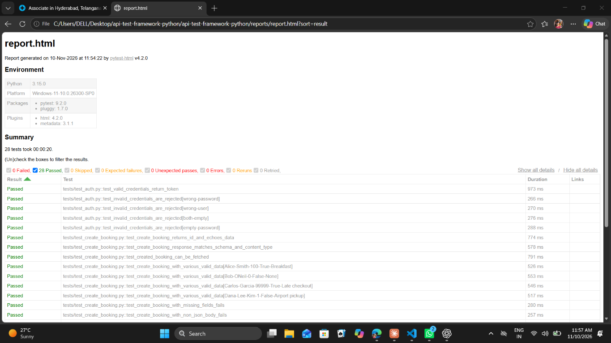
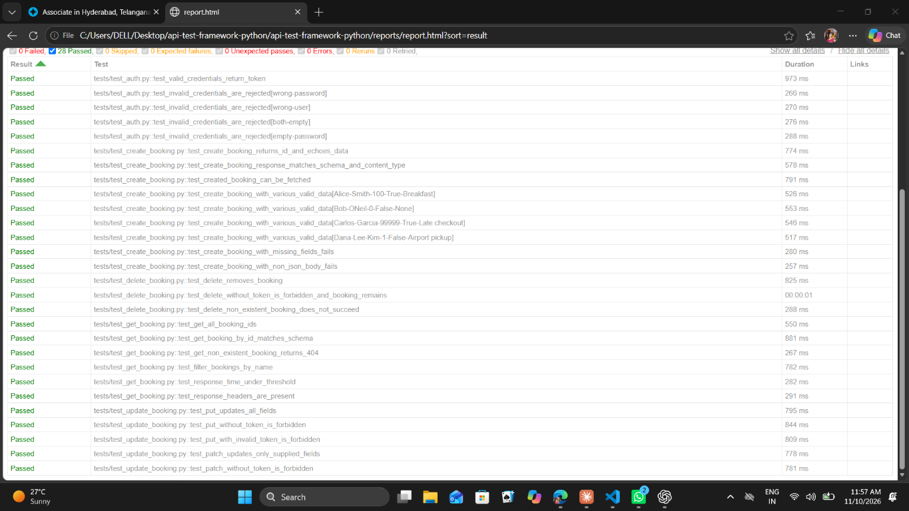

# Restful-Booker API Test Automation (Python)


API test automation framework for the public [Restful-Booker](https://restful-booker.herokuapp.com/apidoc/index.html) service, built with **Python, pytest, requests, jsonschema and GitHub Actions**. The repository also includes test documentation, a Postman collection and a JMeter load test plan.

## What it covers

| Area | Details |
|---|---|
| CRUD | POST, GET, PUT, PATCH, DELETE on `/booking` |
| Authentication | Token from `/auth`, cookie-based auth, missing and invalid token cases |
| Validation | Status codes, headers, response body, response time, JSON schema |
| Data-driven | `pytest.mark.parametrize` for valid bookings and invalid credentials |
| Negative testing | Missing fields, malformed body, no/invalid token, non-existent ids |
| Test documentation | Test plan, 33 test cases, traceability matrix, 8 bug reports, regression checklist |
| Postman | Collection with 18 chained requests and assertions, runnable with Newman |
| Performance | JMeter load test plan with run instructions and a results template |
| Reporting | Self-contained HTML report (pytest-html) |
| CI | GitHub Actions runs smoke then full regression on every push, PR and weekly |

## Design

- **Client layer** (`clients/booking_client.py`): one `requests.Session` with default headers; all endpoints wrapped as methods.
- **Fixtures** (`tests/conftest.py`): session-scoped `client` and `token`; a `new_booking` fixture that creates test data and cleans it up afterwards.
- **Data builder** (`utils/data_builder.py`): unique data per test, so tests are independent and can run in any order.
- **Schema validation** (`utils/schema.py` + `schemas/`): JSON schemas checked with `jsonschema`.
- **Markers**: `smoke`, `regression`, `negative`.
- **Config** (`config.py`): override with environment variables such as `BASE_URL`.

## Project structure

```
clients/        booking_client.py
utils/          data_builder.py, schema.py
schemas/        booking.json, create_booking.json
tests/          conftest.py, test_auth.py, test_create_booking.py,
                test_get_booking.py, test_update_booking.py, test_delete_booking.py
docs/           test-plan.md, test-cases.csv, traceability-matrix.md,
                bug-reports.md, regression-checklist.md
postman/        restful-booker.postman_collection.json,
                restful-booker.postman_environment.json
performance/    restful-booker-load-test.jmx, README.md,
                performance-report-template.md
screenshots/    test report screenshots
.github/workflows/api-tests.yml
pytest.ini, requirements.txt, config.py
```

## Run the automated tests

Prerequisite: Python 3.9+.

```bash
python -m venv .venv
source .venv/bin/activate          # Windows: .venv\Scripts\activate
pip install -r requirements.txt

pytest                             # everything
pytest -m smoke                    # smoke only
pytest -m negative                 # negative tests only
pytest -k "booking and not delete" # filter by name
```

The HTML report is written to `reports/report.html`.

## Test execution report

The suite was executed with pytest and the pytest-html plugin.

| Metric | Result |
|---|---:|
| Total test cases | 28 |
| Passed | 28 |
| Failed | 0 |
| Skipped | 0 |
| Execution time | about 20 seconds |





## Test documentation (`docs/`)

| File | Contents |
|---|---|
| [`test-plan.md`](docs/test-plan.md) | Scope, approach, environment, entry and exit criteria, risks, schedule |
| [`test-cases.csv`](docs/test-cases.csv) | 33 test cases with steps, expected results and status |
| [`traceability-matrix.md`](docs/traceability-matrix.md) | Requirements (REQ-01 to REQ-10) mapped to test cases |
| [`bug-reports.md`](docs/bug-reports.md) | 8 defect reports with steps to reproduce, expected and actual results |
| [`regression-checklist.md`](docs/regression-checklist.md) | Smoke, regression and retest checklist |

## Postman collection (`postman/`)

18 requests in three folders (Health & Auth, Booking CRUD, Negative tests), each with assertions. Requests are chained through environment variables, so run the collection in order.

- **Postman:** import both files from `postman/`, select the *Restful-Booker (public)* environment and use the Collection Runner.
- **Newman:**

```bash
npm install -g newman
newman run postman/restful-booker.postman_collection.json \
  -e postman/restful-booker.postman_environment.json
```

Some negative requests (negative price, reversed dates) check rules the API does not enforce, so they may fail. They document real defects listed in `docs/bug-reports.md`.

## Performance testing (`performance/`)

The JMeter plan `restful-booker-load-test.jmx` runs list, create and get requests per virtual user. Run instructions and the results template are in the `performance/` folder.

```bash
jmeter -n -t performance/restful-booker-load-test.jmx \
  -Jusers=50 -Jrampup=30 -Jloops=5 \
  -l performance/results/results.jtl \
  -e -o performance/results/report
```

Keep the load small, because the target is a shared public API.

## Known API behaviours (documented, not hidden)

- Bad credentials on `/auth` return HTTP 200 with `{"reason": "Bad credentials"}` instead of 401.
- A successful `DELETE` returns 201 instead of 200/204.
- Malformed `POST /booking` bodies return an error status instead of a clean 400.

The tests assert the current behaviour and note where it deviates from REST conventions. See `docs/bug-reports.md` for the full list.